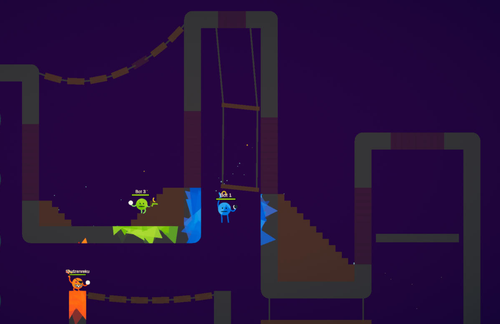

# BotsAI

AI bots for ROUNDS. Author: Shidzenreku13. Source: https://github.com/Shidzen13/BotsAI

## Controls
- **LOCAL lobby:** `B` - add a bot.
- **RoundsWithFriends online room:**
  - `B` - add a bot (it readies itself), `N` - remove the last bot;
  - `1`-`4` - next color (team) for bot #N, `Shift` + `1`-`4` - previous color;
  - hints and the bot list are shown at the bottom-left of the lobby.
- Colors are teams only in Team Deathmatch.

## Online
- Bots count as players, so you can start an online room alone with bots.
- Default: 2 characters per PC (you + 1 bot), same as RWF - safe with friends without this mod.
- Up to 4 bots: set `[Online] MaxCharactersPerClient = 5` in `BepInEx/config/com.kanty.rounds.bots.cfg`.
  Use it alone or when every player has BotsAI with the same value.
- A bot thinks on the PC of the player who added it.

## Requirements
- BepInEx, UnboundLib (installed automatically).
- Online bots need RoundsWithFriends (optional; LOCAL lobby works without it).

## Compatibility
- Tested with a ~30-mod pack (card packs, extra maps, RoundsWithFriends, Toggle Friendly Fire).
- Built-in fixes for mods that treat "the local player" as any character on your PC (your bots included):
  - **RoundsWithFriends** - bots join the online lobby as players, show as "Bot N" with the vanilla face;
  - **Hidden Cards** - you still see your own card choice and card bar, not a bot's;
  - **Infoholic** - the stats panel shows your stats, not a bot's;
  - **Toggle Friendly Fire** - bots read the self-damage setting (e.g. Demonic Pact is only valued when self-damage is off).
- Bots know vanilla cards well. Modded cards are recognised as modded and picked a bit more carefully,
  but bots do not understand their special effects - picks can be odd.
- Unusual modded maps (moving platforms, hazards, closed rooms) can make bots get stuck or play passively.
  A safety rule ends a point after 60 s without damage when only your bots are alive.
- Mods that heavily change movement, blocking or game modes may break bot behaviour.
- Found a problem? Note the mod list and attach `BepInEx/LogOutput.log`.

## Other
- If only your bots are alive and nobody takes damage for 60 s, the weakest bot dies and the point ends
  (`[Bots] ForceEndPointSeconds`, 0 = off).
- Bots know vanilla vs modded cards and respect Toggle Friendly Fire (no self-damage).

---

# BotsAI (UA)

Боти для ROUNDS. Автор: Shidzenreku13.
- LOCAL лобі: `B` - додати бота.
- Онлайн-кімната RWF: `B` - додати, `N` - прибрати, `1`-`4` - колір бота №N вперед, `Shift`+`1`-`4` - назад.
- Вбудована сумісність: RoundsWithFriends (боти як гравці «Bot N»), Hidden Cards (бачиш свої картки), Infoholic (стата — твоя), Toggle Friendly Fire (боти враховують самошкоду).
- Сумісний з більшістю модів карток і мап; модові картки й незвичні мапи боти розуміють гірше — можливі дивні вибори чи застрягання.
- До 4 ботів: `[Online] MaxCharactersPerClient = 5` (лише самому або коли в усіх мод з тим самим значенням).
